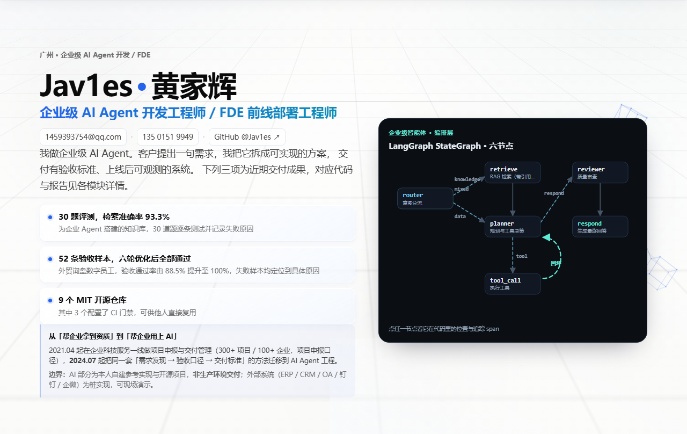

# 黄家辉 · AI 数字化落地作品集



> 从「会规划」到「能落地、可演示、可量化、可复用」

[](https://jav1es.github.io/portfolio/)
[](https://jav1es.github.io/portfolio/)
[](./LICENSE)

[](https://jav1es.github.io/portfolio/works.html)
[](https://github.com/Jav1es/enterprise-agents/tree/main/mcp)
[](https://github.com/Jav1es/enterprise-agents/tree/main/mcp)
[](https://github.com/Jav1es/Harness-Agent-Core)
[](https://github.com/Jav1es/dsh-toolkit)
[](https://github.com/Jav1es/dsh-knowledge-guide)

---

## 📖 目录

- [👋 关于我](#-关于我)
- [🎯 核心亮点](#-核心亮点)
- [🧭 三个目标岗位](#-三个目标岗位)
- [📊 三岗位能力映射](#-三岗位能力映射)
- [📚 作品集：四大能力类目（25 个作品）](#-作品集四大能力类目25-个作品)
- [🖥 现场可演示清单](#-现场可演示清单)
- [🏭 行业定制规划（分类 ⑥）](#-行业定制规划分类-)
- [🛠 技术栈与实现](#-技术栈与实现)
- [📁 仓库结构](#-仓库结构)
- [📢 诚信说明](#-诚信说明)
- [📬 联系我](#-联系我)

---

## 👋 关于我

**黄家辉** · 5 年+ 企业科技服务与项目全流程经验 · 广州 · 计算机应用技术 · 软考中级 · 信息系统项目管理师备考中

目标岗位：**AI 项目经理 / FDE 前线部署工程师 / AI 智能体开发工程师**

我擅长把 AI 从「概念」落到「业务现场」——从需求诊断、方案设计、端到端交付到现场培训，全程打通最后一公里。本作品集是一份完整的**证据链**，每一项都可追溯、可验证、可演示。

---

## 🎯 核心亮点

| 维度 | 内容 |
|---|---|
| **真实项目** | **300+** 政府/企业项目（申报并通过 **200+**）· **100+** 服务企业 · **24 家（含复审）**单年高企通过 · **1 周**最快交付 |
| **工程落地** | **6 层**智能体架构 · **93.3%** RAG 检索准确率@3（30 题） · **35 项**测试通过 |
| **开源贡献** | **3 个** MCP Server + **1 个** 跨应用桥接 + **3 个** DSH 插件 + **1 套** 运维工具箱 + **1 份** 检索规程开源（9 个仓库，其中 3 个含 CI 门禁） |
| **数据驱动** | 每个项目都有**前后对比量化数据**，全部标注口径 |
| **FDE 能力** | **完整能力映射表** + 2 则实战故事（业务型 + 工程型）|
| **能带队** | **5 年+**客户现场交付 · 从诊断到培训全程主导 |

---

## 🧭 三个目标岗位

把 5 年+ 的能力收敛为三条相互支撑的主线——**能规划**（从公司层面搭体系）、**能交付**（深入客户现场端到端落地）、**能实现**（独立完成工程与开源）。三者不是并列的三个身份，而是同一套「把 AI 真正落到业务里」的完整闭环。

| 岗位 | 能力主线 | 核心证据 |
|---|---|---|
| 🎯 **AI 项目经理** | 从公司层面规划 AI 工具体系，跨部门推进落地，用 ROI 量化价值 | 模块 01 规划包（8 业务域 / 6 个月路线图） · 模块 03 财务行政外贸审核流 · 模块 08 培训 / SOP / 推广 · 模块 10 复盘量化 |
| 🚀 **FDE 前线部署工程师** | 进客户门 → 诊断业务 → 端到端交付 → 现场培训 → 用数据量化结果 | 模块 11 一周跑通从签单到申报 · 模块 23 外贸询盘数字员工（52/52 验收样本通过） · 模块 03 高企认定端到端交付 |
| 🤖 **AI 智能体开发工程师** | 独立完成智能体系统的架构、实现、评测与开源 | 模块 04 六层架构 · 模块 13 RAG 真实评测 93.3% · 模块 14 OTel/Jaeger 全链路 · 模块 24 Harness-Agent-Core · 模块 12/15/16/17/18/22 六个开源仓库 |

---

## 📊 三岗位能力映射（含实战故事与交付物）

在线页面用**横向滑动卡片**展示三个岗位：顶部有箭头 / 圆点切换控件，每张卡片纵向拆成「岗位核心要求 → 真实经历对应 → 作品集证据」三段，**并在卡片内直接附上该岗位的实战故事与可复用交付物**——不再另设独立板块。

| 岗位 | 能力要求维度 | 卡内实战故事 | 卡内交付物 |
|---|---|---|---|
| 🎯 **AI 项目经理** | 体系化规划 · 业务场景盘点 · ROI 测算与预算 · 跨部门推动 · 培训推广采纳率 · 数据驱动决策 | 企业 AI 工具体系从 0 到 1：把「各部门各自买工具」变成一套体系 | Discovery Brief 客户发现简报 |
| 🚀 **FDE 前线部署工程师** | 深入一线需求诊断 · 端到端交付 · 业务沟通跨部门 · 快速搭原型现场部署 · 打通最后一公里 · ROI 量化 | ① 高企认定端到端现场交付（业务型）② enterprise-agent 资源受限环境现场部署（工程型） | （含于两条故事中） |
| 🤖 **AI 智能体开发工程师** | 架构设计 · RAG 与检索工程 · 工具调用与 MCP · 记忆与容错 · 部署与工程化 · 评测与可观测性 · 开源与工具链 | RAG 检索从「大概能答」到「有数据可证」：93.3% 是怎么量出来的 | Eval Plan 工程评测计划 |

---

## 📚 作品集：四大能力类目（25 个作品）

25 个作品按**能力属性**归为四大类（核心案例 7、AI 工程化 6、开源工具 6、实验与工具链 6），均可在[在线目录](https://jav1es.github.io/portfolio/works.html) 按类目展开查看。下表由 `works-data.json` 生成——与站点渲染用的是同一份数据，所以这里的数字和页面上看到的一致。

> ★ = 代表作。核心指标为项目自报口径，非第三方基准；
> 标注「测算」「验收目标」「示例」的为方案阶段目标值，未标者为本机实测或台账计数。

### ① 核心案例（7 个）

> 从架构到检索到工具协议，再到评测门禁与交付标准件——一条完整、可点开验证的企业级智能体证据链。

| # | 模块 | 核心指标 |
|---|---|---|
| 04 | 把企业系统接进 Agent，每次工具调用都可追溯 ★ | 6层 企业级智能体架构 · 70% HPA扩缩容CPU阈值 · 5次 熔断器连续失败阈值 |
| 11 | 一周跑通从签单到申报 ★ | 2 份 可复用标准件 · 1 周 签单到申报交付最快记录 · 约 30 家 单年通过客户数（台账口径） |
| 13 | 30 题真实评测，检索准确率 93.3% ★ | 93.3% 检索准确率@3（30 题真实评测） · 28/30 分层命中 · 含5道拒答题 · 40条 示例制度文档 |
| 14 | AI 评测与可观测性：CI 自动回归与全链路追踪 ★ | 8 单会话Jaeger trace span · 30题 CI每次push自动评测 · 609 Locust 压测 0 失败 |
| 16 | 三个 MCP Server，35 个用例全过 ★ | 3个 MCP Server开源 · 35 pytest用例全通过 · 100% 用例通过率 |
| 24 | Harness-Agent-Core：把不可控的 AI 变成可验收的交付 ★ | 70% → 98% 交付成功率（50 次实验口径） · −80% 错误修正平均耗时 · 5 确定性能力层 |
| 25 | 作品集站本身：零依赖、24 个手写 3D 封面 ★ | 0 第三方运行时依赖 · 24 个 手写 Canvas 3D 封面 · 0/449 滚动掉帧（实测） |

### ② AI 工程化（6 个）

> 不是只会调 API：规划选型、Prompt 与评测、业务系统落地、数据口径与复盘，都有方法可循。

| # | 模块 | 核心指标 |
|---|---|---|
| 01 | 八个业务域，六个月路线图 ★ | 8 业务域覆盖（8 大场景） · 6 个月 分阶段路线图 |
| 02 | AI 工作流实践 A：企业智能问答与申报文档生成 | ≥50% 生成效率提升测算（示例） · ≥85% 审核通过率（验收目标 · 示例口径） · 2层 AI先做+人工只审 |
| 03 | AI 工作流实践 B：财务、行政与外贸跟单审核 ★ | RPA+AI 审核流双层分工 · 70% 人工审核量下降测算（示例） · 92% 准确率（验收目标 · 示例口径） |
| 05 | 业务数据库与数据监测报告（SQL 报表 + BI/ChatBI） ★ | 1 套 指标体系与看板模板 · 1 套 ETL 示例链路（含演示脚本） · ChatBI 自然语言取数配置 |
| 07 | Prompt 工程与评测体系 | A/B 对比测试驱动优化 · Schema JSON输出强校验 · 模板化 Prompt结构化沉淀 |
| 23 | 外贸询盘数字员工：从诊断到验收的完整交付（个人演示） ★ | 52/52 验收样本全量通过（100%） · 50% 人工介入降幅 · 6 轮 回归迭代 88% → 100% |

### ③ 开源工具（6 个）

> 不只会用工具，还能造工具——9 个独立公开仓库全部 MIT，从 MCP Server 到宿主插件、离线 PWA 与运维工具链。

| # | 模块 | 核心指标 |
|---|---|---|
| 12 | dsh-bridge：让 Marvis 调用本机 DeepSeek Harness（开源） ★ | 5 MCP 工具（零依赖手写协议） · 本地检索 技能 × MCP 工具索引 · 10 秒 派工单生成耗时 |
| 15 | DeepSeek Harness 本机插件三件套（开源） ★ | 3 自研 DSH 插件 · 推送 / 预览 / 待办 三类能力，均开源 · MIT 开源许可 |
| 17 | 知识指南：把「先检索再作答」写成可复用的规程（开源） ★ | 1 可复用检索规程 · 纯 MD 零构建 · 零运行时依赖 · MIT 开源许可 |
| 18 | dsh-prompt-compiler：可编程的 prompt 编译层（DSH 插件，开源） ★ | v0.4.1 npm + GitHub 已发布 · 3 诊断→澄清→合成三阶段 · 192 自动化测试 · CI 已接入 |
| 19 | DSH 运维工具箱：升级自检 / 插件兼容预检 / 生态全量调研（开源） ★ | 4382 插件目录全量调研 · 3 工具与文档组件 · MIT 开源许可 |
| 22 | 原型工厂：可自检的静态原型与断言引擎（开源） ★ | 74 自动化断言 · 3 个原型实测 · 4 devflow 安装坑（3 个静默失败） · 1 条 命令完成构建与自检 |

### ④ 实验与工具链（6 个）

> 快速实验与内部提效工具：验证过的东西再沉淀成上面那些可交付的模块。

| # | 模块 | 核心指标 |
|---|---|---|
| 06 | 办公流程自动化（影刀 / UiBot RPA + Python 脚本） | 自动化 跨系统重复流程脚本执行 · 兜底 异常告警+人工复核 · SOP 流程与运维文档 |
| 08 | 培训 / SOP / 推广运营包 | 70% 自助解决率（验收目标） · 闭环 反馈收集→处理→迭代 · SOP 带教培训体系 |
| 09 | 一键起服务，故障自动恢复 | Docker Compose一键起服务 · 高可用 容错/重试/降级/熔断 · 监控 日志+告警+压测 |
| 10 | 项目复盘与量化数据报告 ★ | — |
| 20 | 高企认定评分自评系统（离线 PWA） ★ | 6 步 实时算分 · 8 条 一票否决预检 · 0 依赖 零安装零后端 |
| 21 | workbuddy-bridge：让 Marvis 调用本机 WorkBuddy | MCP 标准协议桥接 · 子 Agent 可被上级编排 |

---

## 🖥 现场可演示清单

按三个目标岗位分组，**可现场演示** = 面试当场能跑；**可提供材料** = 提供脱敏文件或录屏。

### 🎯 AI 项目经理

| 内容 | 说明 | 状态 |
|---|---|---|
| AI 工具体系 0-1 规划包 | 业务盘点 → 价值×难度矩阵 → 工具选型 → 6 个月路线图 → ROI 测算 | 可提供材料 |
| 项目监测报告 | 自建业务数据库 + SQL 报表，现场看数据如何驱动决策 | 可现场演示 |
| 方案演练 · 高分子新材料行业信息化规划（示例） | L1-L5 成熟度模型、总体蓝图、业财一体化、8 个专属 AI 场景 | 演练稿，可现场讲解（非客户交付物） |
| 培训 / SOP / 推广运营包 | 操作手册、培训脚本、FAQ、带教 SOP、采纳率看板 | 可提供材料 |

### 🚀 FDE 前线部署工程师

| 内容 | 说明 | 状态 |
|---|---|---|
| enterprise-agent 本地现场部署 | Docker Compose 一键起服务，演示编排 / RAG / 工具调用 / 容错降级 | 可现场演示 |
| 企业问答 / 文档 AIGC 工作流 | Coze + 多维表「AI 先做、人只审」双层流程与人工审核台 | 可现场演示 |
| FDE 交付物模板 | Discovery Brief（客户发现简报）+ Eval Plan（工程评测计划） | 可提供材料（站内可读） |
| 高企认定端到端交付复盘 | 需求诊断 → 研发费用归集 → 材料编制 → 合规自查 → 培训交付 | 可提供材料（脱敏） |

### 🤖 AI 智能体开发工程师

| 内容 | 说明 | 状态 |
|---|---|---|
| RAG 知识库真实演示 | 上传制度文档→提问→返回条款引用；真实评测 93.3% @3（30 题分层） | 可现场演示 |
| OTel + Jaeger 全链路追踪 | 一次会话 7 个 span（root + router/planner/retrieve/tool_call/reviewer/respond），trace_id 贯穿 | 可现场演示 |
| MCP Server 三件套 | 3 个 MCP Server，35 个 pytest 用例全通过 | 可现场演示（仓库公开） |
| dsh-bridge / DSH 插件 / 运维工具箱 | 四个独立开源项目，含 CI 与测试 | 可现场演示（仓库公开） |
| knowledge-guide 检索规程 | SKILL.md 单文件规程，装进 `~/.dsh/skills/` 即被 skill 工具装载 | 可现场演示（纯 Markdown，本仓库存有副本） |

---

## 🏭 行业定制规划（分类 ⑥）

**方案演练 · 高分子新材料行业信息化规划（示例）**

> **性质：能力演练 / 非客户委托 · 未涉及任何客户数据**

按一份真实招聘 JD 与该行业公开资料编写的<b>能力演练稿</b>（建筑密封胶行业，国标起草单位为其行业公开信息）。以「入职后规划」视角，覆盖 ERP / SRM / PLM / MES / HR / LIMS 五大业务系统 + 数据中台 + AI 能力平台 + 基础设施安全，并深度融入 AIGC 与 AI Agent 落地场景。

- **体系化规划**：L1-L5 成熟度模型 + 总体蓝图 + 按系统完善程度推进的优先级矩阵
- **行业深度适配**：配方研发 Copilot、多标准合规核查、批次质量追溯等 8 个专属 AI 场景
- **财务方向强项**：业财一体化、研发费用归集与加计扣除，契合高新技术企业真实需求

> 对应岗位：AI 项目经理（规划主线）· FDE（现场诊断与交付）。演示方式：可提供脱敏版规划书，现场逐页讲解规划逻辑与优先级取舍。

---

## 🛠 技术栈与实现

- **前端**：纯静态 HTML + CSS + 原生 JavaScript，零框架依赖，加载快
- **Markdown 渲染**：marked.js 实现 .md 文件优雅展示（弹模态框）
- **部署**：GitHub Pages（Deploy from a branch, main / root）
- **数据**：所有作品集内容以 JS 数组形式内嵌于 `index.html`，便于维护
- **附件**：PDF / DOCX / XLSX / PNG / SVG / MD 等原始材料按模块分文件夹归档

---

## 📁 仓库结构

```
portfolio/
├── index.html                 # 作品集主页面（含所有模块数据）
├── 01-ai-toolkit/             # 模块 01 附件
├── 02-ecommerce-ai/           # 模块 02 附件
├── 03-finance-admin-trade-ai/ # 模块 03 附件
├── 04-enterprise-agent/       # 模块 04 附件（含 enterprise-agents 子目录）
├── 05-bi-chatbi/              # 模块 05 附件
├── 06-rpa/                    # 模块 06 附件
├── 07-prompt-engineering/     # 模块 07 附件
├── 08-training-sop/           # 模块 08 附件
├── 09-tech-ops/               # 模块 09 附件
├── 10-retro-reports/          # 模块 10 附件
├── 11-fde-templates/          # 模块 11 附件（FDE 交付物模板）
├── 12-dsh-bridge/             # 模块 14 附件（图标 / 技能定义 / 设计取舍 / MCP 参考 / 排错手册）
├── 15-dsh-plugins/            # 模块 15 附件（插件总览 README）
├── 17-knowledge-guide/        # 模块 17 附件（SKILL.md 规程全文 + 说明 README）
└── README.md                  # 本文件
```

> 模块 16（dsh-toolkit）与模块 17（dsh-knowledge-guide）的证明链接指向独立开源仓库；
> 模块 17 另在本仓库存了规程副本 `./17-knowledge-guide/knowledge-guide-SKILL.md`，
> 便于现场离线打开。
> ⚠️ GitHub Pages **不会发布文件名为 `*SKILL.md` 的文件**（模块 14 的 `dsh-bridge-SKILL.md` 同样 404），
> 因此模块 17 的「规程全文」链接指向 `raw.githubusercontent.com`，`README.md` 链接仍走站内弹层。
>
> ⚠️ 旧 PDF 书稿链路 `_book/` 已于 2026-10-20 废弃删除（口径「5 年+」与站点「6 年+」矛盾，
> 且 PDF 按 brief §0 禁止公开下载）。站点的**唯一有效源是根目录 `*.html`**；简历 PDF 由
> `build-resume-pdf.mjs` 生成，**已提交到仓库**（`resume-*.pdf` 共 4 份，随 Pages 发布供直接下载）。

---

## ➕ 新增作品（一条命令上线）

作品数据以 `works-data.json` 为**唯一编辑口**。新增作品只需在 `items` 里追加一条对象，
**不用写编号**（会自动顺延），然后跑一条命令：

```bash
node build.mjs          # 构建 + 自检，不推送
node build.mjs --ship   # 构建通过后直接提交并推送，约 2-3 分钟上线
```

`build.mjs` 会依次完成：`patch-works` → `enrich-works` → `inline-preview` →
产物一致性校验 → 编号连续性校验 → 卡片几何自检（桌面 / 移动 / 首页）。
**任何一步失败都会立刻停下，不会把坏页面推上线。**

新作品的最小字段：

```jsonc
{
  "t": "作品标题",           // 必填
  "cat": "agent",           // 必填：plan / flow / agent / data / oss / industry
  "status": "已发布",
  "jd": "AI 智能体开发工程师",
  "pitch": "一句话说清做成了什么",
  "highlights": [{ "num": "3 个", "label": "关键指标" }],
  "tags": ["MCP", "LangGraph"],
  "links": ["GitHub 仓库：xxx|https://github.com/Jav1es/xxx"],
  "role": "我负责什么",      // 可选：不写则「展开详情」只有摘要
  "arch": "架构 / 方案",     // 可选
  "steps": ["第一步", "第二步"], // 可选
  "pain": "解决的痛点"        // 可选
}
```

- **编号**：不写 `no` 就自动取当前最大编号 +1；写了则保留（用于插到指定位置）。
- **分组**：不写 `group` 就按 `cat` 自动归入（`agent`/`data`→AI 工程化，
  `oss`→开源工具，`plan`/`flow`/`industry`→核心案例）。
- 每个新增作品都会自动进入首页精选区与岗位页，无需手工改任何 HTML。

> 数据管线原本依赖 `.dsh-workspace/artifacts/legacy-singlepage.html`（旧单页，未入库）。
> 现在该文件**只在首次全量重建时需要**，日常新增作品直接改 `works-data.json` 即可。

---

## 📢 诚信说明

- **真实项**：企业级智能体系统 enterprise-agent、高企认定 / 项目申报交付、自建项目信息数据库与《项目监测报告》均为本人真实经历。
- **演练项**：高分子新材料行业信息化规划为按真实招聘 JD 与行业公开资料编写的**能力演练稿，非客户委托、未涉及任何客户数据**，不构成客户案例。
- **口径说明**：凡成效类数字均标注为「测算模型 / 示例口径」，实际以落地数据为准。
- **脱敏处理**：部分客户名称与年度数据已做脱敏，面试时可提供更详细版本。

---

## 📬 联系我

- **在线作品集**：[https://jav1es.github.io/portfolio/](https://jav1es.github.io/portfolio/)
- **GitHub**：[@Jav1es](https://github.com/Jav1es)
- **联系方式**：面试时提供

---

<p align="center">
  <i>本作品集持续更新中，欢迎交流与指正。</i>
</p>
